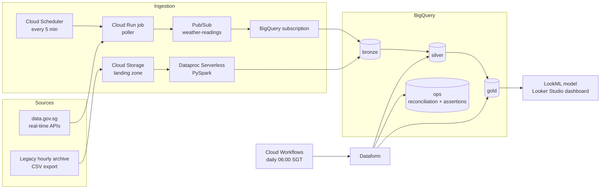

# Singapore Weather Data Platform on GCP

An end-to-end data platform on Google Cloud for Singapore weather data. It covers:
- a **migration** of a legacy hourly archive, with reconciliation
- a **real-time stream** of readings from ~90 national weather stations
- **medallion layers** (bronze, silver, gold) in BigQuery
- automated **data-quality** checks
- a **semantic layer** for reporting

All infrastructure is defined in Terraform.

> **Project status:** I deployed and ran this platform on a personal GCP project in October 2026, then tore the infrastructure down with `terraform destroy` to avoid ongoing costs. Everything needed to rebuild it from an empty project is in this repository: see [docs/setup.md](docs/setup.md).



## Components

| Layer | Service | What it does |
|---|---|---|
| Real-time ingestion | Cloud Scheduler → Cloud Run job | Polls 5 data.gov.sg endpoints (temperature, rainfall, humidity, wind speed, wind direction) and publishes one Pub/Sub message per station reading, stamped with event time |
| Streaming load | Pub/Sub BigQuery subscription | Writes every message straight into `bronze.weather_readings_raw` with its message ID and publish time. No pipeline to run |
| Migration | Cloud Storage → Dataproc Serverless (PySpark) | Loads the legacy CSV archive into bronze, adding UTC timestamps and source-file lineage |
| Transformation | Dataform (SQLX) | Parses and validates raw messages (invalid ones go to quarantine), then builds silver (deduplicated, standardised units, sources unified at cutover) and gold (daily per-station and island-wide summaries) |
| Data quality | Dataform assertions | Uniqueness, not-null and value-range checks; migration reconciliation; real-time freshness; quarantine rate |
| Orchestration | Cloud Workflows + Cloud Scheduler | Compiles Dataform from Git, runs it, and fails the execution on any error or failed assertion |
| Semantic layer | LookML (`lookml/`), Looker Studio | Standard metric definitions over the gold layer |
| Monitoring | Cloud Monitoring | Alerts on failed transforms, failed polls, an ingestion backlog and budget thresholds |
| Delivery | GitHub Actions, Cloud Build | CI runs ruff, pytest, `dataform compile` and `terraform validate`. Terraform is planned on every pull request (posted as a PR comment) and applied on merge to `main`. Cloud Build tests the poller, builds its image and deploys it |

## Data layers

| Dataset | Tables | Notes |
|---|---|---|
| `bronze` | `weather_readings_raw`, `legacy_observations`, `legacy_stations` | Data as it landed: raw JSON messages and typed legacy rows. Schemas owned by Terraform |
| `silver` | `readings_parsed` (view), `readings_clean` (incremental MERGE), `readings_quarantine`, `stations`, `observations_hourly` | Duplicates removed, knots → km/h, the legacy `-999` sentinel → NULL, circular mean for wind direction. Legacy data before `cutover_date`, stream data from it |
| `gold` | `daily_station_weather`, `island_daily_summary` | Partitioned by `obs_date`, clustered by station |
| `ops` | `reconciliation_legacy`, assertion views, `legacy_manifest_ext` | Audit trail of every reconciliation run |

Column-level details: [docs/data-mapping.md](docs/data-mapping.md).

## Design decisions

- **Load raw, validate in SQL.** A BigQuery subscription lands every message unchanged, so nothing is lost even if a payload is malformed. Dataform parses the JSON with `SAFE` functions: valid rows go to `readings_clean`, and invalid ones go to `readings_quarantine` with the reason and the original payload. An assertion fails the run if more than 1% of a day's messages are quarantined.
- **At-least-once delivery, deduplicated downstream.** Pub/Sub can redeliver, and the poller re-publishes readings the API has not updated yet. `silver.readings_clean` merges on `(metric, station_id, reading_ts)`, so duplicates never reach gold.
- **Bronze is faithful to the source.** The migration keeps legacy values unchanged, including `-999`, so bronze can be reconciled exactly against the extract's control totals. All cleaning happens in silver.
- **Reconciliation is part of the run, not a one-off.** `ops.reconciliation_legacy` compares row counts and column sums per file against the manifest. An assertion fails the run, and so raises an alert, on any file that doesn't match.
- **Least privilege.** Each component has its own service account. Roles are granted on the specific topic, subscription, bucket or dataset wherever IAM allows it. Workers run on a private subnet with no public IPs, using Private Google Access. The GitHub token for Dataform lives in Secret Manager and is never in Terraform state.
- **Keyless CI/CD for infrastructure.** GitHub Actions logs in to GCP through Workload Identity Federation, which trusts only this repository's ID. Pull requests plan with a read-only identity; only `main`-branch runs can use the identity that applies. There are no service-account keys to leak.
- **Terraform owns infrastructure, CI/CD owns releases.** The Cloud Run job is created with a placeholder image and Terraform ignores image changes. Cloud Build rolls out new versions.
- **Cost.** Gold tables are partitioned and clustered for the dashboard's date and station filters. Cloud Workflows replaces Cloud Composer, because a scheduled dbt-style DAG doesn't need an always-on Airflow environment. A BigQuery subscription replaces an always-on streaming pipeline, since the readings need no processing in flight. Dataproc Serverless bills only while the migration runs. A budget alert tracks spend before credits.

## Repository layout

```
ingest/poller/          Cloud Run job: data.gov.sg → Pub/Sub
ingest/legacy_extract/  Builds the legacy archive and its manifest of control totals
dataproc/               PySpark migration job: legacy CSV → bronze
definitions/            Dataform models (silver, gold, ops) and assertions
workflow_settings.yaml  Dataform project settings (Dataform compiles from the repo root)
orchestration/          Cloud Workflows definition for the daily run
lookml/                 LookML model and views over gold
terraform/              All GCP infrastructure
scripts/                Migration runner
tests/                  Unit tests for the poller and the legacy extract
docs/                   Setup guide, migration runbook, data mapping
```

## Getting started

See [docs/setup.md](docs/setup.md) for setup from an empty GCP project, and [docs/migration-runbook.md](docs/migration-runbook.md) for the migration and cutover.

```bash
pip install -r requirements-dev.txt
pytest
ruff check .
```

## Data sources

- Real-time readings: [data.gov.sg](https://data.gov.sg) weather APIs (National Environment Agency), under the Singapore Open Data Licence.
- Historical archive: [Open-Meteo](https://open-meteo.com) historical weather API (CC BY 4.0), sampled at each station's coordinates and written in a legacy export format. These are modelled hourly values, not the stations' own historical readings.
